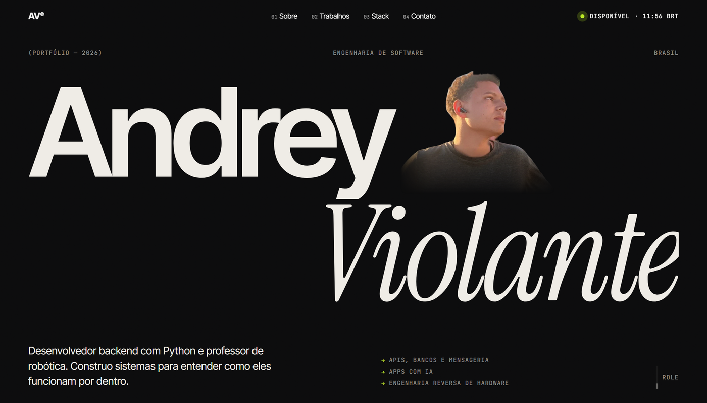
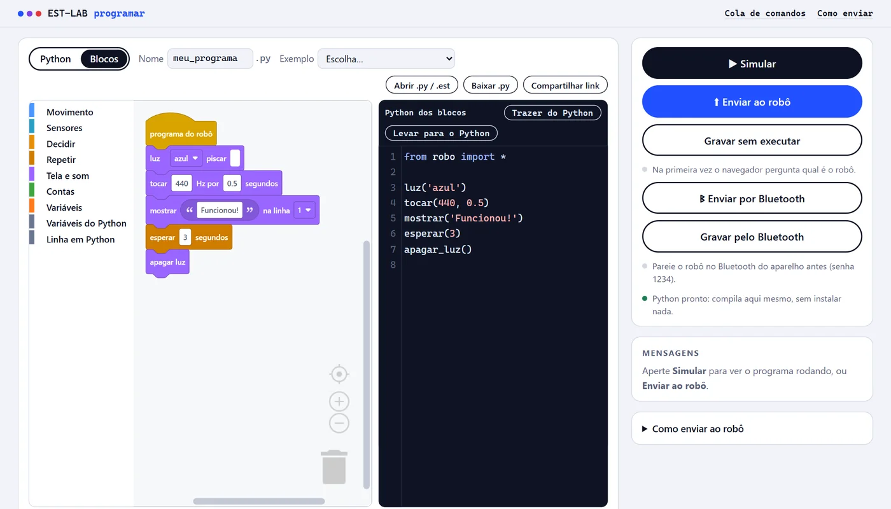

## Olá, eu sou o Andrey 👋

Estudante de Engenharia de Software (6º período), focado em **backend com Python**, e professor de robótica desde 2023.
Aprendo construindo: APIs com mensageria, apps Android nativos e até a engenharia reversa
do protocolo de um robô educacional que não tinha documentação nenhuma.

No momento estou estudando arquiteturas com mensageria (RabbitMQ/Kafka) e serviços em containers.

## 🌐 Conheça meu portfólio

  

## ⭐ Projetos principais

<h2 align="center">🗣️ <a href="https://hi-kiara.vercel.app">Hi, Kiara!</a></h2>

  

Assistente virtual para alunos do 6º ao 9º ano praticarem inglês conversando por **voz ou texto**, no ritmo de cada um.
O aluno escolhe o ano, os temas do currículo e um modo: explicação, questões críticas ou **role-play**, em que a Kiara
vira um personagem e o aluno ganha uma missão.

O método é **socrático**: ela pergunta antes de responder, para o aluno pensar e tentar. No fim, um resumo traz as
correções, as palavras novas e o treino de pronúncia, pronto para imprimir.

Virou uma ferramenta de sala de aula, com **painel do professor** por turma, progresso e medalhas, opções de
acessibilidade e regras de segurança para menores de idade. Projeto de escola, apresentado na Mostra Pedagógica
de Maricá. O código é privado, mas o app está aberto no link.

  

React Native · Expo · TypeScript · Vercel · Postgres · LLM · Reconhecimento e síntese de voz

<h2 align="center">🤖 <a href="https://andreyviolante.github.io/est-robot/">EST-LAB</a></h2>

  

O robô educacional **Dr. Luck EST** só podia ser programado por uma IDE fechada e sem nenhuma documentação pública.
Capturei e analisei o tráfego USB, mapeei o **protocolo HID** e o formato binário dos programas, e escrevi um
**compilador próprio**, testado byte a byte contra a IDE oficial: 13 de 13 programas de referência idênticos.

Em cima dele criei uma **linguagem em português** para aulas de robótica. O aluno programa no **VS Code** ou no
**navegador**, em Python ou com **blocos**, e testa num **simulador** com desafios e arena da OBR. Os erros aparecem
explicados em português, com a linha e uma sugestão de correção.

O projeto é gratuito e de código aberto (versão 0.1.6, licença MIT), tem guia do professor com 8 aulas, guia para
equipes da OBR e [DOI no Zenodo](https://doi.org/10.5281/zenodo.23692767). Uso o projeto nas aulas de robótica e na
preparação da equipe para a OBR.

  
  
  

Python · Engenharia reversa · HID/USB · Compiladores · VS Code · Robótica educacional

## Outros projetos

<h3 align="center">💰 <a href="https://github.com/AndreyViolante/Finance-Ai">Finance-Ai</a></h3>

<picture>
  <source media="(prefers-color-scheme: dark)" srcset="assets/flow-finance-ai-dark.png">
  
</picture>

App Android de finanças pessoais que registra os gastos sozinho: lê as notificações de compra do banco,
extrai o valor e monta um painel com renda, despesas fixas, saldo livre e meta de economia. Os dados ficam só no celular.

React Native · Expo · TypeScript · Java · MMKV

<h3 align="center">📱 <a href="https://github.com/AndreyViolante/RegionWatcher">RegionWatcher</a></h3>

<picture>
  <source media="(prefers-color-scheme: dark)" srcset="assets/flow-regionwatcher-dark.png">
  
</picture>

App Android que vigia uma área da tela e avisa quando ela muda, usando captura via MediaProjection
e comparação por hash perceptual (dHash).

Kotlin · Jetpack Compose · Foreground Service

<h3 align="center">🎓 <a href="https://github.com/AndreyViolante/Moodle-Assistente">Moodle-Assistente</a></h3>

<picture>
  <source media="(prefers-color-scheme: dark)" srcset="assets/flow-moodle-assistente-dark.png">
  
</picture>

Assistente de desktop para o AVA da faculdade. Consulta a API do Moodle, ordena as entregas por urgência,
avisa por notificação do Windows quando um prazo se aproxima e abre um tutor com IA que já leu o enunciado e os PDFs da atividade.

Python · API REST · CustomTkinter · Gemini

<h3 align="center">⚙️ <a href="https://github.com/AndreyViolante/Estudos-Backend">Estudos-Backend</a></h3>

Exercícios de backend da faculdade: APIs em FastAPI com PostgreSQL, MongoDB, RabbitMQ e Kafka, em Docker.

FastAPI · PostgreSQL · MongoDB · RabbitMQ · Kafka · Docker

## Tecnologias

---

Aberto a oportunidades de **estágio** e **backend júnior**. Me chama no [LinkedIn](https://linkedin.com/in/andrey-violante).
